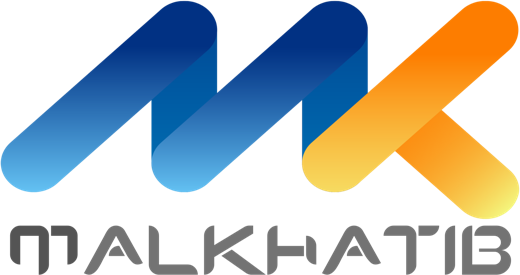
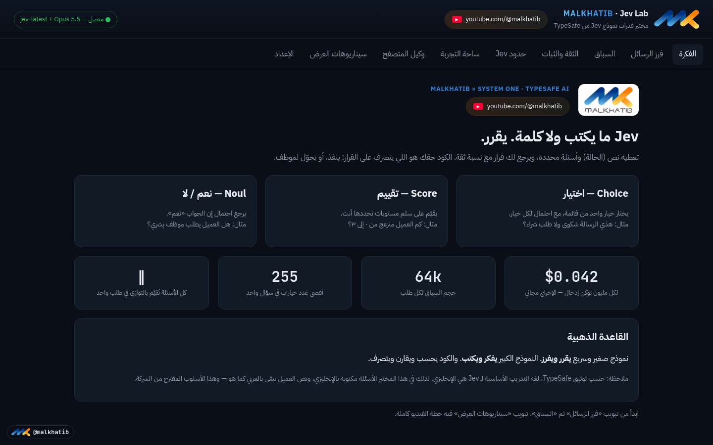
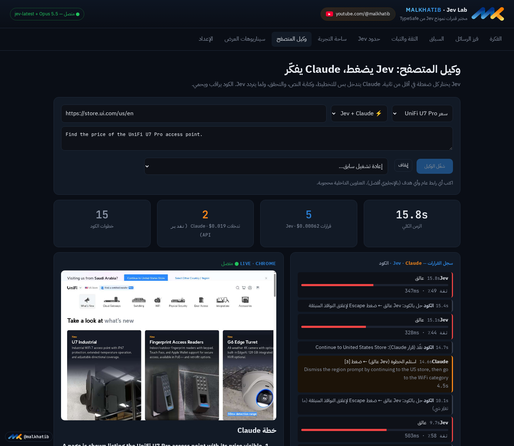

<div align="center">

<a href="https://www.youtube.com/@malkhatib"></a>

# Jev Lab — مختبر قدرات نموذج Jev

**جرّب بنفسك نموذج Jev من TypeSafe: يقرر ولا يكتب، في أقل من نص ثانية.**

[](https://www.youtube.com/@malkhatib)
[](#-التشغيل-السريع)
[](LICENSE)

هذا المشروع من فيديو قناة **[Malkhatib على يوتيوب](https://www.youtube.com/@malkhatib)**.
شوف الفيديو، وبعدها شغّل النظام على جهازك وجرّب بنفسك. لو عجبك، اشترك في القناة 🔔

[English summary ↓](#english)

</div>

<div dir="rtl">

## 📌 وش هو Jev Lab؟

**Jev** نموذج ذكاء اصطناعي من [TypeSafe](https://typesafe.ai/) **ما يكتب ولا كلمة**. تعطيه نص وسؤال وخيارات، ويرجع لك **القرار مع نسبة ثقة**. مثلاً: شكوى 92٪، طلب شراء 6٪، أخرى 2٪. ولما ما يكون متأكد، النسبة تنزل، والكود يحوّل الرسالة لموظف.

**القاعدة الذهبية:** نموذج صغير وسريع **يقرر ويفرز**. النموذج الكبير (Claude) **يفكر ويكتب**. والكود **يحسب ويتصرف**.

Jev Lab تطبيق ويب عربي يعرض هذا الكلام بتجارب حيّة، بالعامية السعودية:

| التبويب | وش يسوي |
|---|---|
| **الفكرة** | أنواع أسئلة Jev الثلاثة: اختيار (Choice)، تقييم (Score)، نعم/لا (Noul). |
| **فرز الرسائل** | يفرز رسائل العملاء: شكوى، شراء، دعم فني، استرجاع… مع نسبة الثقة والتحويل لموظف. فيه كمان: ٢٠ رسالة دفعة وحدة مع حاسبة تكلفة شهرية، وحارس البوابة (كشف محاولات الاختراق)، وتقييم العملاء، وتحليل التقييمات. |
| **السباق** | نفس الرسالة على Jev وعلى Claude Opus جنب بعض: الزمن والتكلفة. |
| **Jev ضد OpenAI Decisions** | 🆕 نفس النص ونفس الأسئلة على Jev وعلى `gpt-6-luna` من [OpenAI Decisions API](https://developers.openai.com/api/docs/guides/decisions): مؤقتين، تكلفة، ونسبة الاتفاق. فيه اختبار دقة على ٢٠ رسالة جوابها معروف (بأسئلة إنجليزي أو عربي)، وتحليل صور (مطالبة استرجاع، صورة إعلان) — الصور يقرأها Decisions فقط. |
| **الثقة والثبات** | هل يتغير الجواب لو غيّرنا ترتيب الخيارات؟ والرسالة الغامضة. |
| **حدود Jev** | وين ما ينفع Jev (العدّ والحساب والتواريخ)، ومقارنته بدالة كود. |
| **ساحة التجربة** | اكتب سؤالك وخياراتك بنفسك. |
| **وكيل المتصفح** | وكيل يتصفح أي موقع عام: Jev يضغط، Claude يخطط ويكتب ويتحقق، والكود يراقب. بث حي للمتصفح + سجل لكل قرار. |
| **سيناريوهات العرض** | خطة الفيديو والمقاطع القصيرة. |
| **الإعداد** | مكان إدخال المفاتيح. |

### لقطات

<div align="center">
<br><br>

</div>

## 🧰 المتطلبات

1. **Docker** مع **Docker Compose** ([Docker Desktop](https://www.docker.com/products/docker-desktop/) في ويندوز وماك، أو Docker Engine في لينكس).
2. **مفتاح TypeSafe (Jev)** — سوّه من [console.typesafe.ai/keys](https://console.typesafe.ai/keys). **لازم.**
3. **Claude (اختياري):** يحتاجه «السباق» الحي و«وكيل المتصفح». واحد من اثنين:
   - **توكن اشتراك Claude** (Pro / Max): ثبّت [Claude Code](https://docs.anthropic.com/en/docs/claude-code) في جهازك، وشغّل `claude setup-token`، وانسخ التوكن اللي يبدأ بـ `sk-ant-oat`.
   - أو **مفتاح Anthropic API** من [console.anthropic.com](https://console.anthropic.com/) (للسباق فقط).
4. **مفتاح OpenAI API (اختياري):** لتبويب «Jev ضد OpenAI Decisions». سوّه من [platform.openai.com/api-keys](https://platform.openai.com/api-keys). Decisions API يحتاج مفتاح API (ما يشتغل باشتراك ChatGPT)، وحط حد إنفاق للمشروع. السعر المنشور: ‎$0.10 لكل مليون توكن إدخال، والإخراج مجاني.

بدون Claude كل التبويبات تشتغل، والسباق يعرض **تقدير** تكلفة النموذج الكبير بدل التشغيل الحي.

## 🚀 التشغيل السريع

```bash
git clone https://github.com/makhatib/jev-lab.git
cd jev-lab
docker compose up -d --build
```

أول بناء ياخذ كم دقيقة. بعدها:

1. افتح **http://localhost:8080/setup**
2. الصق مفتاح TypeSafe واضغط **«حفظ وتحقق»**.
3. (اختياري) الصق توكن اشتراك Claude أو مفتاح Anthropic API، ومفتاح OpenAI للمقارنة مع Decisions.
4. افتح **http://localhost:8080** وابدأ من تبويب «فرز الرسائل» ثم «السباق».

**الإيقاف:** `docker compose down` · **التحديث:** `git pull && docker compose up -d --build`

### بديل: المفاتيح في ملف `.env`

لو تفضّل ما تستخدم صفحة الإعداد:

```bash
cp .env.example .env
# افتح .env واكتب المفاتيح
docker compose up -d --build
```

ملف `.env` موجود في `.gitignore`، فما ينرفع لـ GitHub أبداً.

## 🔐 المفاتيح والأمان

- **ما فيه أي مفتاح أو توكن داخل الكود.** كل واحد يستخدم مفاتيحه هو.
- المفاتيح اللي تحطها في صفحة الإعداد تنحفظ في **Docker volume** اسمه `jev-data` (الملف `/data/keys.json` داخل الحاوية)، مو في مجلد المشروع.
- لمسح المفاتيح وكل البيانات: `docker compose down -v`
- التطبيق يفتح على **`127.0.0.1` فقط** (جهازك أنت). **لا تفتحه للإنترنت بدون حماية**، لأن صفحة الإعداد تقبل مفاتيح وأي أحد يوصل لها يقدر يستخدم رصيدك.
  - لو شغّلته على سيرفر بعيد، افتحه بنفق SSH:
    `ssh -L 8080:127.0.0.1:8080 user@your-server` وبعدها افتح `http://localhost:8080`.
  - أو حطه خلف reverse proxy عليه تسجيل دخول (Basic Auth أو SSO).
- **توكن اشتراك Claude شخصي.** استخدمه لنفسك فقط. لو بتشارك النظام مع غيرك، استخدم مفتاح API بحد إنفاق.

## 🤖 وكيل المتصفح: كيف يشتغل

```
   أنت ── هدف + رابط ──►  Claude يخطط (أهداف قصيرة)
                              │
              ┌───────────────┴───────────────┐
              ▼                               ▼
   Jev يختار الضغطة التالية          Claude يكتب النص المطلوب
   (≈0.3 ث، مع نسبة ثقة)              ويستلم لما Jev يتردد
              │                               │
              └──────► الكود ينفّذ ويراقب ◄────┘
                              │
                      Claude يتحقق من النتيجة ── ✔ / ✘
```

- **وضعين:** «⚡ Jev + Claude» أو «🧠 Claude لحاله». شغّل نفس المهمة بالوضعين، ويطلع **جدول مقارنة** تلقائي (الزمن، عدد الطلبات، التكلفة).
- **مهمتك الخاصة:** اختر «✎ مهمتي الخاصة» واكتب أي رابط عام وأي هدف (بالإنجليزي أفضل).
- **إعادة التشغيل:** «إعادة تشغيل سابق…» تعرض صور كل خطوة، مفيدة للتصوير البطيء.
- **ملاحظة:** تكلفة Claude تنعرض **بسعر API كتقدير**، حتى لو تستخدم الاشتراك. والأرقام تختلف من تشغيل لتشغيل.

### حمايات مدمجة

- Chrome معزول في حاوية لحاله، بجلسة **نظيفة لكل تشغيل**، وما فيه أي حساب.
- Chrome **ما يوصل للإنترنت إلا عن طريق proxy** يسمح بالعناوين العامة فقط (منافذ 80/443). الشبكة المحلية وجهازك محجوبة.
- **بحث وقراءة فقط:** الكود يرفض أزرار الشراء والسلة وتسجيل الدخول والإرسال والحذف.
- حدود لكل تشغيل: 40 خطوة، 16 طلب Claude، 180 ثانية (وضع Claude لحاله: 45 طلب و300 ثانية). تقدر تغيّرها في أعلى `agent/service.py`.
- تشغيل واحد في نفس الوقت.

## 🏗️ مكونات النظام

| الخدمة | الوظيفة |
|---|---|
| `proxy` | Caddy: نقطة الدخول الوحيدة على `127.0.0.1:8080`. يوجّه `/agent/*` للوكيل والباقي للتطبيق. |
| `web` | Node.js: الواجهة العربية + API لـ Jev + السباق (Claude Code CLI أو Anthropic SDK) + OpenAI Decisions. |
| `agent` | Python (FastAPI): وكيل المتصفح، مبني على [browser-use/jev-ultrafast](https://github.com/browser-use/jev-ultrafast). |
| `chrome` | Headless Chromium على شبكة داخلية فقط. |
| `egress` | Proxy يسمح لـ Chrome بالعناوين العامة فقط. |

### إعدادات

| المتغير | الافتراضي | الوصف |
|---|---|---|
| `JEV_LAB_PORT` | `8080` | المنفذ على جهازك. |
| `TYPESAFE_API_KEY` | — | مفتاح Jev (أو من صفحة الإعداد). |
| `CLAUDE_CODE_OAUTH_TOKEN` | — | توكن اشتراك Claude (أو من صفحة الإعداد). |
| `ANTHROPIC_API_KEY` | — | مفتاح API بديل للسباق. |
| `OPENAI_API_KEY` | — | مفتاح OpenAI لمقارنة Decisions (أو من صفحة الإعداد). |
| `DECISIONS_MODEL` | `gpt-6-luna` | نموذج OpenAI Decisions. |

## 🛠️ حل المشاكل

| المشكلة | الحل |
|---|---|
| المنفذ 8080 مستخدم | اكتب `JEV_LAB_PORT=8090` في `.env` وأعد التشغيل. |
| «مفتاح TypeSafe غير صحيح» | تأكد إنك نسخت المفتاح كامل من console.typesafe.ai/keys. |
| البث الحي أسود في «وكيل المتصفح» | انتظر ثواني بعد «شغّل الوكيل». النقطة الخضراء جنب LIVE تعني متصل. |
| الوكيل وقف بـ blocked | السبب مكتوب بالعربي في سطر النتيجة. جرّب هدف أوضح، مثلاً «أعلى سوار Fitbit تقييماً مع سعره» بدل «Best band». |
| بعض المواقع تطلب «اختيار الدولة» | طبيعي. Claude يتعامل معها، بس الزمن يزيد. |
| «مفتاح OpenAI غير صحيح» أو خطأ 403 من OpenAI | تأكد إن المفتاح من مشروع فيه رصيد، وإن حسابك عنده وصول لـ Decisions API (نسخة تجريبية). |
| أبي أشوف السجلات | `docker compose logs -f agent web` |

## 🙏 شكر

- [TypeSafe](https://typesafe.ai/) — نموذج Jev.
- [browser-use/jev-ultrafast](https://github.com/browser-use/jev-ultrafast) — أساس وكيل المتصفح (رخصة MIT، النسخة المضمّنة في `agent/jev_ultrafast/`).
- [Anthropic Claude](https://www.anthropic.com/claude) — التخطيط والكتابة والتحقق.
- [OpenAI Decisions API](https://developers.openai.com/api/docs/guides/decisions) — `gpt-6-luna` للمقارنة.

هذا مشروع تعليمي مستقل. مو تابع لـ TypeSafe ولا Anthropic ولا OpenAI. أرقام الأسعار والسرعة حسب تجاربنا وأرقام TypeSafe المنشورة، وممكن تتغير.

</div>

---

<a id="english"></a>

## English

**Jev Lab** is an Arabic demo app for [TypeSafe's Jev](https://typesafe.ai/), a model that never writes text: it returns a decision with a confidence score in under half a second. The app shows message triage, a live race against Claude Opus, a **head-to-head with OpenAI's Decisions API (`gpt-6-luna`)** including a 20-message accuracy check and image decisions, confidence tests, Jev's limits, a playground, and a **browser agent** where Jev picks the clicks and Claude plans, writes and verifies.

Built for the **[Malkhatib YouTube channel](https://www.youtube.com/@malkhatib)**.

```bash
git clone https://github.com/makhatib/jev-lab.git && cd jev-lab
docker compose up -d --build
# open http://localhost:8080/setup and paste your TypeSafe key (https://console.typesafe.ai/keys)
```

- **No keys ship with this repo.** Keys you enter are stored in the `jev-data` Docker volume; `.env` is git-ignored.
- Claude is optional: a Claude subscription token (`claude setup-token`) or an Anthropic API key.
- OpenAI is optional: an OpenAI API key enables the Jev vs Decisions tab.
- The app binds to `127.0.0.1` only. Do not expose it to the internet without authentication.
- MIT license. `agent/jev_ultrafast/` is vendored from browser-use/jev-ultrafast (MIT).

<div align="center">

<a href="https://www.youtube.com/@malkhatib"></a><br>
<b><a href="https://www.youtube.com/@malkhatib">youtube.com/@malkhatib</a></b>

</div>
