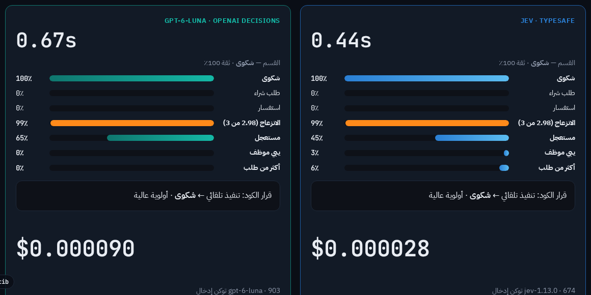
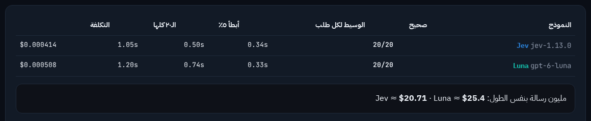

<div align="center">

<a href="https://www.youtube.com/@malkhatib"></a>

# Jev Lab — مختبر قدرات نموذج Jev

**جرّب بنفسك نموذج Jev من TypeSafe: يقرر ولا يكتب، في أقل من نص ثانية.**<br>
**وقارنه وجهاً لوجه مع OpenAI Decisions (`gpt-6-luna`).**

[](https://www.youtube.com/@malkhatib)
[](#openai)
[](#-التشغيل-السريع)
[](LICENSE)

هذا المشروع من فيديو قناة **[Malkhatib على يوتيوب](https://www.youtube.com/@malkhatib)**.
شوف الفيديو، وبعدها شغّل النظام على جهازك وجرّب بنفسك. لو عجبك، اشترك في القناة 🔔

[⚔️ Jev ضد OpenAI Decisions ↓](#openai) · [English summary ↓](#english)

</div>

<div dir="rtl">

## 📌 وش هو Jev Lab؟

**Jev** نموذج ذكاء اصطناعي من [TypeSafe](https://typesafe.ai/) **ما يكتب ولا كلمة**. تعطيه نص وسؤال وخيارات، ويرجع لك **القرار مع نسبة ثقة**. مثلاً: شكوى 92٪، طلب شراء 6٪، أخرى 2٪. ولما ما يكون متأكد، النسبة تنزل، والكود يحوّل الرسالة لموظف.

**القاعدة الذهبية:** نموذج صغير وسريع **يقرر ويفرز**. النموذج الكبير (Claude) **يفكر ويكتب**. والكود **يحسب ويتصرف**.

Jev Lab تطبيق ويب عربي يعرض هذا الكلام بتجارب حيّة، بالعامية السعودية:

| التبويب | وش يسوي |
|---|---|
| **الفكرة** | أنواع أسئلة Jev الثلاثة: اختيار (Choice)، تقييم (Score)، نعم/لا (Noul). |
| **فرز الرسائل** | يفرز رسائل العملاء: شكوى، شراء، دعم فني، استرجاع… مع نسبة الثقة والتحويل لموظف. فيه كمان: ٢٠ رسالة دفعة وحدة مع حاسبة تكلفة شهرية، وحارس البوابة (كشف محاولات الاختراق)، وتقييم العملاء، وتحليل التقييمات. |
| **السباق** | نفس الرسالة على Jev وعلى Claude Opus جنب بعض: الزمن والتكلفة. |
| **Jev ضد OpenAI Decisions** | 🆕 نفس النص ونفس الأسئلة على Jev وعلى `gpt-6-luna` من [OpenAI Decisions API](https://developers.openai.com/api/docs/guides/decisions): مؤقتين، تكلفة، ونسبة الاتفاق. فيه اختبار دقة على ٢٠ رسالة جوابها معروف (بأسئلة إنجليزي أو عربي)، وتحليل صور (مطالبة استرجاع، صورة إعلان) — الصور يقرأها Decisions فقط. |
| **الثقة والثبات** | هل يتغير الجواب لو غيّرنا ترتيب الخيارات؟ والرسالة الغامضة. |
| **حدود Jev** | وين ما ينفع Jev (العدّ والحساب والتواريخ)، ومقارنته بدالة كود. |
| **ساحة التجربة** | اكتب سؤالك وخياراتك بنفسك. |
| **وكيل المتصفح** | وكيل يتصفح أي موقع عام: Jev يضغط، Claude يخطط ويكتب ويتحقق، والكود يراقب. بث حي للمتصفح + سجل لكل قرار. |
| **سيناريوهات العرض** | خطة الفيديو والمقاطع القصيرة. |
| **الإعداد** | مكان إدخال المفاتيح. |

### لقطات

<div align="center">
<br><br>
<br><br>

</div>

<a id="openai"></a>

## ⚔️ Jev ضد OpenAI Decisions

### وش هو Decisions؟

[OpenAI Decisions API](https://developers.openai.com/api/docs/guides/decisions) واجهة جديدة من OpenAI بنموذج **`gpt-6-luna`** (نسخة تجريبية عامة). نفس فكرة Jev بالضبط: **ما يكتب نص**، يرجع قرار مع احتمال. يعني OpenAI دخلت نفس الفئة، وهذا يثبت إن «نموذج صغير يقرر» صار نمط معتمد.

| | **Jev** (TypeSafe) | **Decisions** (OpenAI) |
|---|---|---|
| النموذج | `jev-1.13.0` | `gpt-6-luna` (تجريبي) |
| أنواع الأسئلة | `choice` · `score` · `noul` | `choice` · `score` · `predicate` |
| يقرأ الصور؟ | ❌ نص فقط | ✅ (base64) |
| السعر المنشور (إدخال) | ‎$0.042 لكل مليون توكن | ‎$0.10 لكل مليون توكن |
| الإخراج | مجاني | مجاني |
| المفتاح | [console.typesafe.ai/keys](https://console.typesafe.ai/keys) | [platform.openai.com/api-keys](https://platform.openai.com/api-keys) — مفتاح API، **ما يشتغل باشتراك ChatGPT** |

> السعر لكل توكن مو كل القصة: في تجاربنا Luna يحسب تقريباً **نص عدد التوكنات** لنفس الرسالة، فالتكلفة الفعلية طلعت **متقاربة**.

### وش في التبويب؟

التطبيق يرسل **نفس النص ونفس الأسئلة** للنموذجين، و**نفس الكود** يقرر على أجوبتهم. الكود يحوّل بين صيغة Jev وصيغة Decisions (`noul` ↔ `predicate`) عشان المقارنة تكون عادلة.

1. **نفس الرسالة، نموذجين:** فرز الرسائل، حارس البوابة، تقييم العملاء، تحليل التقييمات. لكل نموذج مؤقت وتكلفة، وجدول «اتفقوا في كم سؤال». تقدر تخلي **كل الأسئلة بالعربي**.
2. **اختبار الدقة (٢٠ رسالة):** ٢٠ رسالة بالعامية، كل وحدة جوابها الصح معروف. يطلع كم صح لكل نموذج، والوسيط وأبطأ ٥٪ من الطلبات، والتكلفة. الأخطاء والرفض تنعرض لحالها، وتقدير «مليون رسالة» يختفي لو فشل أي طلب.
3. **فخ ترتيب الخيارات:** نفس السؤال، والخيارات مرة بالترتيب ومرة معكوسة. مين يغيّر جوابه؟
4. **الصور (Decisions فقط):**
   - **مطالبة استرجاع:** صورة المنتج + كلام العميل ← موظف بأولوية، أو موظف يراجع، أو «أرسل صورة أوضح». **الكود ما يعتمد استرجاع من صورة أبداً**، القرار دايماً لموظف. ولو الصورة ما تطابق كلام العميل، تروح لموظف مع السبب.
   - **صورة إعلان في سوق إلكتروني:** نشر، أو إعادة تصوير، أو رفض (مثلاً لو فيها رقم جوال).

<div align="center">

</div>

### نتائجنا (في تجربتنا، أكتوبر 2026)

| | Jev | Luna |
|---|---|---|
| اختبار الـ٢٠ (أسئلة إنجليزي) | **20/20** · وسيط 0.30 ث | **20/20** · وسيط 0.33 ث |
| اختبار الـ٢٠ (أسئلة عربي) | **20/20** · وسيط 0.28 ث | **20/20** · وسيط 0.31 ث |
| أبطأ طلب | ~0.5 ث | ~2.2 ث |
| التكلفة لكل ٢٠ رسالة | ~$0.0005 | ~$0.0005 |
| اتفقوا على نفس القرار | 18 من 19 رسالة | 18 من 19 رسالة |
| فخ ترتيب الخيارات | ثابت في كل الرسائل | غيّر جوابه في رسالتين غامضتين |
| الصور | — | ✅ أقل من ثانية لكل صورة |

**الخلاصة: ما فيه فائز ثابت.** في فرز النصوص الاثنين متقاربين في الدقة والسرعة والتكلفة. Decisions يقرأ الصور. Jev كان أثبت في فخ الترتيب في تجربتنا. الأرقام تتغير من تشغيل لتشغيل، شغّلها بنفسك.

### جرّبها بنفسك

1. شغّل التطبيق ([التشغيل السريع](#-التشغيل-السريع)).
2. سوّ مفتاح من [platform.openai.com/api-keys](https://platform.openai.com/api-keys)، وحط **حد إنفاق** للمشروع (٥ دولار تكفي وزيادة).
3. الصقه في `http://localhost:8080/setup` في خانة «مفتاح OpenAI API»، أو اكتبه في `.env` كـ `OPENAI_API_KEY`.
4. افتح تبويب **«Jev ضد OpenAI Decisions»**. بدون مفتاح OpenAI، جهة Jev تشتغل لحالها.

## 🧰 المتطلبات

1. **Docker** مع **Docker Compose** ([Docker Desktop](https://www.docker.com/products/docker-desktop/) في ويندوز وماك، أو Docker Engine في لينكس).
2. **مفتاح TypeSafe (Jev)** — سوّه من [console.typesafe.ai/keys](https://console.typesafe.ai/keys). **لازم.**
3. **Claude (اختياري):** يحتاجه «السباق» الحي و«وكيل المتصفح». واحد من اثنين:
   - **توكن اشتراك Claude** (Pro / Max): ثبّت [Claude Code](https://docs.anthropic.com/en/docs/claude-code) في جهازك، وشغّل `claude setup-token`، وانسخ التوكن اللي يبدأ بـ `sk-ant-oat`.
   - أو **مفتاح Anthropic API** من [console.anthropic.com](https://console.anthropic.com/) (للسباق فقط).
4. **مفتاح OpenAI API (اختياري):** لتبويب «Jev ضد OpenAI Decisions». سوّه من [platform.openai.com/api-keys](https://platform.openai.com/api-keys). Decisions API يحتاج مفتاح API (ما يشتغل باشتراك ChatGPT)، وحط حد إنفاق للمشروع. السعر المنشور: ‎$0.10 لكل مليون توكن إدخال، والإخراج مجاني.

بدون Claude كل التبويبات تشتغل، والسباق يعرض **تقدير** تكلفة النموذج الكبير بدل التشغيل الحي.

## 🚀 التشغيل السريع

```bash
git clone https://github.com/makhatib/jev-lab.git
cd jev-lab
docker compose up -d --build
```

أول بناء ياخذ كم دقيقة. بعدها:

1. افتح **http://localhost:8080/setup**
2. الصق مفتاح TypeSafe واضغط **«حفظ وتحقق»**.
3. (اختياري) الصق توكن اشتراك Claude أو مفتاح Anthropic API، ومفتاح OpenAI للمقارنة مع Decisions.
4. افتح **http://localhost:8080** وابدأ من تبويب «فرز الرسائل» ثم «السباق».

**الإيقاف:** `docker compose down` · **التحديث:** `git pull && docker compose up -d --build`

### بديل: المفاتيح في ملف `.env`

لو تفضّل ما تستخدم صفحة الإعداد:

```bash
cp .env.example .env
# افتح .env واكتب المفاتيح
docker compose up -d --build
```

ملف `.env` موجود في `.gitignore`، فما ينرفع لـ GitHub أبداً.

## 🔐 المفاتيح والأمان

- **ما فيه أي مفتاح أو توكن داخل الكود.** كل واحد يستخدم مفاتيحه هو.
- المفاتيح اللي تحطها في صفحة الإعداد تنحفظ في **Docker volume** اسمه `jev-data` (الملف `/data/keys.json` داخل الحاوية)، مو في مجلد المشروع.
- لمسح المفاتيح وكل البيانات: `docker compose down -v`
- التطبيق يفتح على **`127.0.0.1` فقط** (جهازك أنت). **لا تفتحه للإنترنت بدون حماية**، لأن صفحة الإعداد تقبل مفاتيح وأي أحد يوصل لها يقدر يستخدم رصيدك.
  - لو شغّلته على سيرفر بعيد، افتحه بنفق SSH:
    `ssh -L 8080:127.0.0.1:8080 user@your-server` وبعدها افتح `http://localhost:8080`.
  - أو حطه خلف reverse proxy عليه تسجيل دخول (Basic Auth أو SSO).
- **توكن اشتراك Claude شخصي.** استخدمه لنفسك فقط. لو بتشارك النظام مع غيرك، استخدم مفتاح API بحد إنفاق.

## 🤖 وكيل المتصفح: كيف يشتغل

```
   أنت ── هدف + رابط ──►  Claude يخطط (أهداف قصيرة)
                              │
              ┌───────────────┴───────────────┐
              ▼                               ▼
   Jev يختار الضغطة التالية          Claude يكتب النص المطلوب
   (≈0.3 ث، مع نسبة ثقة)              ويستلم لما Jev يتردد
              │                               │
              └──────► الكود ينفّذ ويراقب ◄────┘
                              │
                      Claude يتحقق من النتيجة ── ✔ / ✘
```

- **وضعين:** «⚡ Jev + Claude» أو «🧠 Claude لحاله». شغّل نفس المهمة بالوضعين، ويطلع **جدول مقارنة** تلقائي (الزمن، عدد الطلبات، التكلفة).
- **مهمتك الخاصة:** اختر «✎ مهمتي الخاصة» واكتب أي رابط عام وأي هدف (بالإنجليزي أفضل).
- **إعادة التشغيل:** «إعادة تشغيل سابق…» تعرض صور كل خطوة، مفيدة للتصوير البطيء.
- **ملاحظة:** تكلفة Claude تنعرض **بسعر API كتقدير**، حتى لو تستخدم الاشتراك. والأرقام تختلف من تشغيل لتشغيل.

### حمايات مدمجة

- Chrome معزول في حاوية لحاله، بجلسة **نظيفة لكل تشغيل**، وما فيه أي حساب.
- Chrome **ما يوصل للإنترنت إلا عن طريق proxy** يسمح بالعناوين العامة فقط (منافذ 80/443). الشبكة المحلية وجهازك محجوبة.
- **بحث وقراءة فقط:** الكود يرفض أزرار الشراء والسلة وتسجيل الدخول والإرسال والحذف.
- حدود لكل تشغيل: 40 خطوة، 16 طلب Claude، 180 ثانية (وضع Claude لحاله: 45 طلب و300 ثانية). تقدر تغيّرها في أعلى `agent/service.py`.
- تشغيل واحد في نفس الوقت.

## 🏗️ مكونات النظام

| الخدمة | الوظيفة |
|---|---|
| `proxy` | Caddy: نقطة الدخول الوحيدة على `127.0.0.1:8080`. يوجّه `/agent/*` للوكيل والباقي للتطبيق. |
| `web` | Node.js: الواجهة العربية + API لـ Jev + السباق (Claude Code CLI أو Anthropic SDK) + OpenAI Decisions. |
| `agent` | Python (FastAPI): وكيل المتصفح، مبني على [browser-use/jev-ultrafast](https://github.com/browser-use/jev-ultrafast). |
| `chrome` | Headless Chromium على شبكة داخلية فقط. |
| `egress` | Proxy يسمح لـ Chrome بالعناوين العامة فقط. |

### إعدادات

| المتغير | الافتراضي | الوصف |
|---|---|---|
| `JEV_LAB_PORT` | `8080` | المنفذ على جهازك. |
| `TYPESAFE_API_KEY` | — | مفتاح Jev (أو من صفحة الإعداد). |
| `CLAUDE_CODE_OAUTH_TOKEN` | — | توكن اشتراك Claude (أو من صفحة الإعداد). |
| `ANTHROPIC_API_KEY` | — | مفتاح API بديل للسباق. |
| `OPENAI_API_KEY` | — | مفتاح OpenAI لمقارنة Decisions (أو من صفحة الإعداد). |
| `DECISIONS_MODEL` | `gpt-6-luna` | نموذج OpenAI Decisions. |

## 🛠️ حل المشاكل

| المشكلة | الحل |
|---|---|
| المنفذ 8080 مستخدم | اكتب `JEV_LAB_PORT=8090` في `.env` وأعد التشغيل. |
| «مفتاح TypeSafe غير صحيح» | تأكد إنك نسخت المفتاح كامل من console.typesafe.ai/keys. |
| البث الحي أسود في «وكيل المتصفح» | انتظر ثواني بعد «شغّل الوكيل». النقطة الخضراء جنب LIVE تعني متصل. |
| الوكيل وقف بـ blocked | السبب مكتوب بالعربي في سطر النتيجة. جرّب هدف أوضح، مثلاً «أعلى سوار Fitbit تقييماً مع سعره» بدل «Best band». |
| بعض المواقع تطلب «اختيار الدولة» | طبيعي. Claude يتعامل معها، بس الزمن يزيد. |
| «مفتاح OpenAI غير صحيح» أو خطأ 403 من OpenAI | تأكد إن المفتاح من مشروع فيه رصيد، وإن حسابك عنده وصول لـ Decisions API (نسخة تجريبية). |
| أبي أشوف السجلات | `docker compose logs -f agent web` |

## 🙏 شكر

- [TypeSafe](https://typesafe.ai/) — نموذج Jev.
- [browser-use/jev-ultrafast](https://github.com/browser-use/jev-ultrafast) — أساس وكيل المتصفح (رخصة MIT، النسخة المضمّنة في `agent/jev_ultrafast/`).
- [Anthropic Claude](https://www.anthropic.com/claude) — التخطيط والكتابة والتحقق.
- [OpenAI Decisions API](https://developers.openai.com/api/docs/guides/decisions) — `gpt-6-luna` للمقارنة.

هذا مشروع تعليمي مستقل. مو تابع لـ TypeSafe ولا Anthropic ولا OpenAI. أرقام الأسعار والسرعة حسب تجاربنا وأرقام TypeSafe المنشورة، وممكن تتغير.

</div>

---

<a id="english"></a>

## English

**Jev Lab** is an Arabic demo app for [TypeSafe's Jev](https://typesafe.ai/), a model that never writes text: it returns a decision with a confidence score in under half a second. The app shows message triage, a live race against Claude Opus, a **head-to-head with OpenAI's Decisions API (`gpt-6-luna`)**, confidence tests, Jev's limits, a playground, and a **browser agent** where Jev picks the clicks and Claude plans, writes and verifies.

### Jev vs OpenAI Decisions

OpenAI's [Decisions API](https://developers.openai.com/api/docs/guides/decisions) (`gpt-6-luna`, public beta) works like Jev: no generated text, just a decision with a probability. It also reads images. The **Jev vs OpenAI Decisions** tab sends the same text and the same questions to both models, and the same code acts on both answers. It has four parts: same message side by side, a 20-message labelled accuracy test (English or Arabic questions), an option-order trap (does the answer change when the options are reversed?), and image decisions (Decisions only; a refund is never auto-approved from a photo).

| In our test (Oct 2026) | Jev | Luna |
|---|---|---|
| 20-message test, EN / AR questions | 20/20 · 20/20 | 20/20 · 20/20 |
| Median latency | ~0.3 s | ~0.3 s |
| Slowest request | ~0.5 s | ~2.2 s |
| Cost per 20 messages | ~$0.0005 | ~$0.0005 |
| Option-order trap | stable | flipped on 2 ambiguous messages |
| Images | no | yes |

No fixed winner: text accuracy, speed and cost are close; Decisions reads images; Jev was more stable in the option-order trap in our runs. You need an **OpenAI API key** (a ChatGPT subscription does not work); set a spend limit on the project.

Built for the **[Malkhatib YouTube channel](https://www.youtube.com/@malkhatib)**.

```bash
git clone https://github.com/makhatib/jev-lab.git && cd jev-lab
docker compose up -d --build
# open http://localhost:8080/setup and paste your TypeSafe key (https://console.typesafe.ai/keys)
```

- **No keys ship with this repo.** Keys you enter are stored in the `jev-data` Docker volume; `.env` is git-ignored.
- Claude is optional: a Claude subscription token (`claude setup-token`) or an Anthropic API key.
- OpenAI is optional: an OpenAI API key enables the Jev vs Decisions tab.
- The app binds to `127.0.0.1` only. Do not expose it to the internet without authentication.
- MIT license. `agent/jev_ultrafast/` is vendored from browser-use/jev-ultrafast (MIT).

<div align="center">

<a href="https://www.youtube.com/@malkhatib"></a><br>
<b><a href="https://www.youtube.com/@malkhatib">youtube.com/@malkhatib</a></b>

</div>
